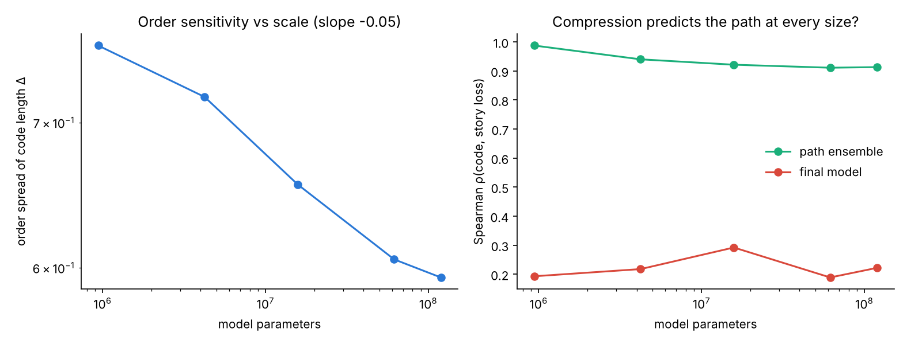

# Exp 11 Part B results: order sensitivity of compression vs model size

90 runs: 5 sizes (0.9M-119M parameters) x 6 orders x 3 seeds, path ensemble on. Settings
were frozen in `DESIGN.md` before any run. Raw runs are in `results/runs/order/`, logs in
`results/logs/`, and the table, fit and figure come from `analyze11.py`.

| Size | Params | Runs | Mean learnable code (bits/token) | Order spread Δ | ρ(code, path-ensemble story loss) | ρ(code, final-model story loss) |
|---|---|---|---|---|---|---|
| m1 | 0.9M | 18 | 2.385 | 0.760 | 0.99 | 0.19 |
| m4 | 4.2M | 18 | 1.901 | 0.719 | 0.94 | 0.22 |
| m16 | 15.8M | 18 | 1.689 | 0.655 | 0.92 | 0.29 |
| m64 | 61.7M | 18 | 1.552 | 0.605 | 0.91 | 0.19 |
| m128 | 119.4M | 18 | 1.500 | 0.594 | 0.91 | 0.22 |

## Pre-registered hypotheses

- **H-B1 held.** Δ decreases at every step in size.
- **H-B2 held.** log Δ is linear in log N, with R² = 0.988. The exponent is **−0.054**.
- **H-B3 held.** The Spearman ρ of code with the path ensemble's story loss is at least
  **0.91** at every size. For the final model it stays at 0.19-0.29.

## What it means

- **Bigger models are more order-invariant, i.e. more Bayesian in this sense, but very
  slowly.** At an exponent of −0.054, halving the order spread would need about 2^18 times
  more parameters. Within the range tested, scale does not remove order dependence.
- **Exp 08 survives scaling.** "Compression predicts the path, not the endpoint" holds at
  every size, over two orders of magnitude.
- **Replication check.** At m4, the absolute range across orders is 1.37 bits/token.
  Exp 05 reported 1.36.

## Exploratory (not pre-registered)

| Size | Range across orders (bits/token) | Δ over adaptive orders only (random, maxloss, rho, lp) |
|---|---|---|
| m1 | 1.81 | 0.102 |
| m4 | 1.37 | 0.094 |
| m16 | 1.11 | 0.086 |
| m64 | 0.94 | 0.075 |
| m128 | 0.89 | 0.069 |

- **The absolute range shrinks faster than Δ.** Its log-log slope is −0.15.
- **Static orders dominate the spread.** The worst order is hard-first at every size, and
  the best is max-loss. Among the four adaptive orders alone, the spread is about 7-10% and
  shrinks with slope −0.08.

## Limitations

- **Three seeds per cell.** The fit uses five points.
- **The two largest sizes share a depth of 12 layers.** Some of the flattening between them
  may come from width-only scaling.
- **Data and steps are fixed (1,500 steps).** Larger models may be further from convergence,
  so size and degree of training are confounded.
- **Learning rates.** Pretraining LRs were set per size by a fixed rule, not tuned.
- **Extrapolation is not supported.** The data cover 0.9M-119M parameters only.

## Cost

One RTX 4090 for 4.2 hours (about $3.8).

There was one infrastructure failure, at m128. Each checkpoint held 10 path snapshots,
about 5-6 GB, and was written to a temp file before replacing the old one. Four such runs at
once filled the 30 GB disk, and the order script then switched to keeping one copy on disk.
One run also hit a GPU out-of-memory error with three runs sharing the card, and was resumed
alone.

None of this changes any computation: resumed runs are identical to uninterrupted ones. That
was checked in Exp 05.
